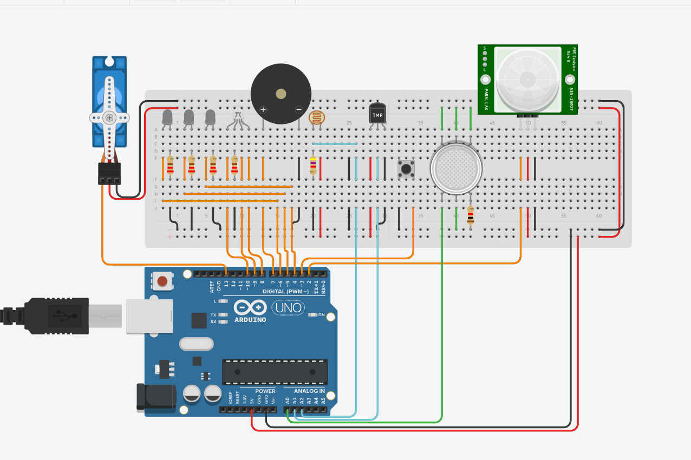

# Smart House – Arduino Automation & Safety System

Team project for **ENGG200 – Introduction to Engineering**, Lebanese International University (Fall 2025).

**My role:** Team leader of a 3-member team. I designed and simulated the second part of the house in Tinkercad and wrote part of the Arduino control code.

## Features
- **Automatic lighting:** an LDR switches the house lights on when it gets dark.
- **Gas-leak detection:** gas sensor triggers the alarm and opens the window (servo) for ventilation.
- **Fire / over-temperature detection:** TMP36 sensor triggers the alarm and opens the window.
- **Intruder detection:** PIR motion sensor triggers the alarm in Sleep mode; the window stays closed.
- **Three operating modes:**
  - `NORMAL` – lighting and gas/fire safety active
  - `SLEEP` – adds intruder detection
  - `EMERGENCY` – buzzer on, red RGB LED blinking
- **Push button:** toggles Normal/Sleep and resets an intruder alarm.

## Components (simulated in Tinkercad)
| Component | Pin |
|---|---|
| Arduino Uno | – |
| LDR (light sensor) | A2 |
| TMP36 temperature sensor | A1 |
| Gas sensor | A0 |
| PIR motion sensor | D8 |
| Push button | D6 |
| 3 × LEDs (house lights) | D12, D13, D2 |
| RGB LED (status) | D9, D11, D10 |
| Buzzer | D7 |
| Servo motor (window) | D3 |

## Control logic
1. Read all sensors every 100 ms.
2. Gas or temperature above threshold → `EMERGENCY` + open window.
3. Motion while in `SLEEP` → latched intruder alarm → `EMERGENCY` (window closed).
4. When gas/temperature return to normal, the system goes back to `NORMAL`; an intruder alarm stays on until the button is pressed.

## Debugging notes
- The first version read the TMP36 with the LM35 formula (`V × 100`), which adds about 50 °C to every reading. Fixed to `(V − 0.5) × 100`.
- The analog pin numbers in the code did not match the wiring (the gas input was reading an unconnected pin, causing random alarms). Pins were corrected to match the circuit: gas A0, temperature A1, LDR A2. After the fix, the simulation reads about 25 °C and a stable gas value in normal conditions.

## Status
Work in progress. This repository contains the latest available version of the code and the circuit. The final report and presentation will be added.

## What I learned
- Integrating several analog and digital sensors with one microcontroller
- Designing state-based control logic (modes and alarm priorities)
- Leading a small team and splitting hardware and software tasks
